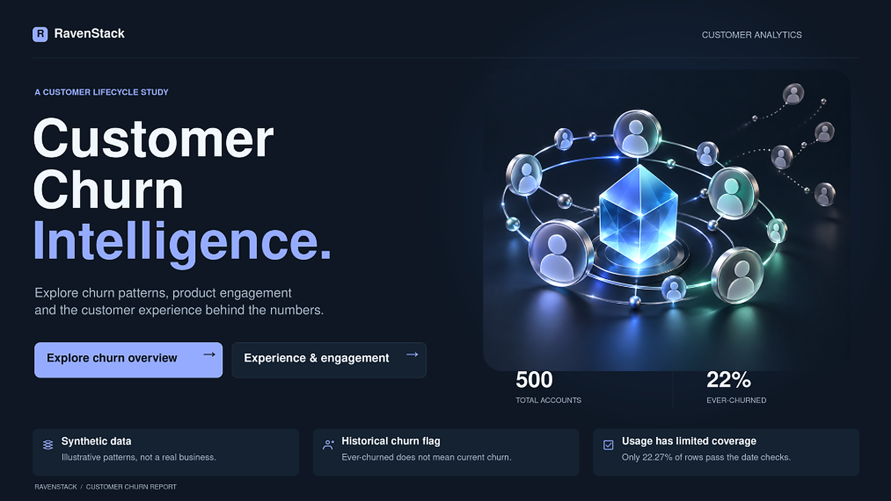
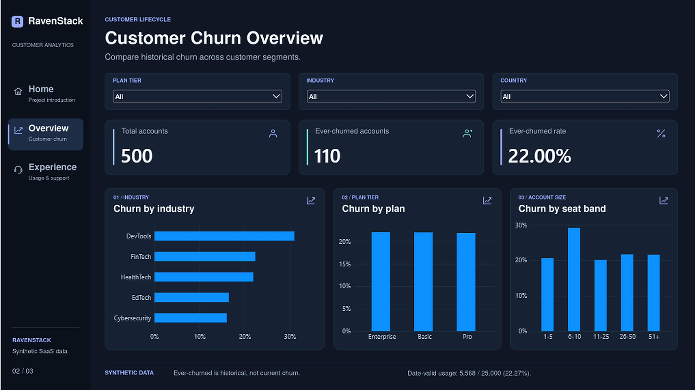
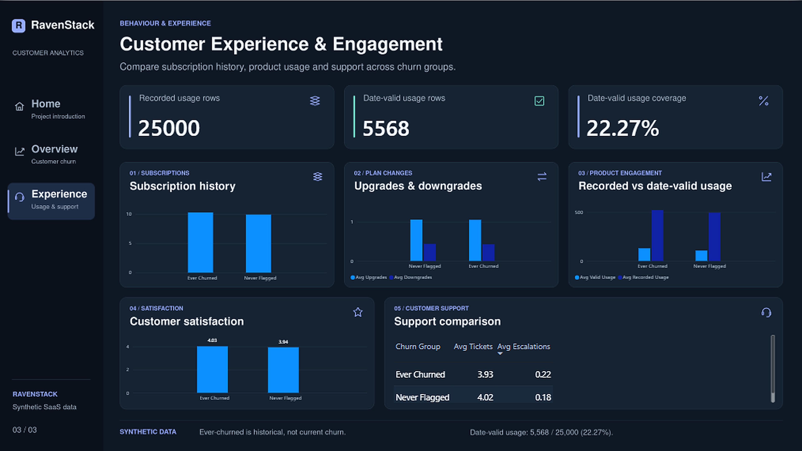

# RavenStack — Customer Churn & Retention Analysis

**An end-to-end descriptive data analytics case study** using **SQL Server → Python → Power BI** to explore historical churn flags, subscription behavior, product engagement, and customer support across a synthetic multi-table SaaS dataset.

> **Scope:** Descriptive / exploratory analytics, not churn prediction or machine learning. The historical `churn_flag` identifies accounts **ever flagged as churned**; it is **not** a current-status label or monthly churn rate.

## Dashboard preview

### Home / Cover


### Customer Churn Overview


### Customer Experience & Engagement


Interactive report: [`powerbi/Ravenstack.pbix`](powerbi/Ravenstack.pbix) (requires Power BI Desktop).

## Business objectives

- Compare **ever-churned percentages** by industry, plan tier, and account size.
- Summarize subscription history (including upgrade and downgrade flags) by churn group.
- Compare recorded product usage with usage that passes **date-window validity** checks.
- Explore customer support activity and available satisfaction scores across churn groups.
- Explain data-quality limits and avoid unsupported causal interpretations.

## Dataset and attribution

**RavenStack: Synthetic SaaS Dataset (Multi-Table)** — credited in the source dataset README to **River @ Rivalytics**. Its accompanying description requests attribution for educational and portfolio use and describes the data as fully synthetic. Author's supplied blog: [Rivalytics on Medium](https://rivalytics.medium.com).

The source description calls its terms *“MIT-like”*; this repository **does not interpret that label as a verified MIT license** or grant additional redistribution rights. Original raw CSV files are **not bundled** here. Obtain the files from the original publisher according to their terms. A precise downloadable dataset URL has not been independently verified.

| Source table | Rows |
|---|---:|
| Accounts | 500 |
| Subscriptions | 5,000 |
| Feature usage | 25,000 |
| Support tickets | 2,000 |
| Churn events | 600 |
| **Total source rows** | **33,100** |

The tables are imported into SQL Server under the `raw` schema; processed account-level measures are exposed through `analytics.vw_account_360`.

## Workflow

```text
Five raw CSV tables
        ↓
SQL Server: import → relational integrity / data quality review → analytical views → validation
        ↓
Python: read analytics.vw_account_360 → account-level EDA → export processed CSV
        ↓
Power BI: three-page interactive descriptive report
```

### SQL — data review and feature preparation

The SQL stage uses five ordered scripts in [`sql/`](sql/) and builds account-level analytical views. Checks include duplicate IDs, relationships, signup/subscription/usage-date consistency, support timings, and account vs event churn-status caveats. The original `feature_usage.usage_id` includes repeated values, so `FEUS_ID` serves as the surrogate key without silently deleting records.

**Important:** `00_database_setup.sql` creates the database and schemas, **not the imported source tables**. Import the five CSV files individually as documented in [`docs/SQL_SETUP.md`](docs/SQL_SETUP.md); run `01_database_foundation.sql` **once** after import, then scripts `02`–`04` in order. The project does not claim fully automated raw-table creation/import.

### Python — exploratory data analysis

[`notebooks/customer_churn_eda.ipynb`](notebooks/customer_churn_eda.ipynb) connects to SQL Server with SQLAlchemy/pyodbc, reads `analytics.vw_account_360`, analyzes customer groups and data coverage, and exports `data/processed/ravenstack_account_360.csv` for reporting. The notebook is descriptive, without a prediction model. See [`docs/PYTHON_SETUP.md`](docs/PYTHON_SETUP.md).

### Power BI — report

The report comprises **Home**, **Customer Churn Overview**, and **Customer Experience & Engagement** with navigation, KPI cards, slicers, segment comparisons, product engagement, subscription history, and customer support. See [`docs/POWERBI_SETUP.md`](docs/POWERBI_SETUP.md) for desktop opening, navigation and refresh considerations.

## Selected findings

| Measure | Result | Interpretation |
|---|---:|---|
| Accounts | **500** | Distinct account-level records |
| Ever-churned accounts | **110** | Historical account flag |
| Ever-churned share | **22.00%** | 110 / 500; **not** a monthly churn rate |
| Recorded feature-usage rows | **25,000** | All logged usage rows |
| Date-valid feature-usage rows | **5,568** | Pass signup and subscription-window checks |
| Date-valid usage-row coverage | **22.27%** | 5,568 / 25,000 |

- **Industry variation:** DevTools has a higher observed ever-churned share (35 of 113 accounts; approximately 30.97%) than some other segments. These are historical group comparisons, not causal evidence.
- **Subscription behavior:** Mean subscriptions per account are similar across groups (approximately 10.29 for Ever Churned versus 9.92 for Never Flagged).
- **Support and satisfaction:** The dashboard shows average tickets/escalations by account and mean available valid satisfaction scores (approximately 4.03 Ever Churned vs 3.94 Never Flagged). These comparisons are descriptive and should not be interpreted as proof of drivers.

## Data quality and interpretation limitations

1. **Synthetic data:** The dataset is fictional; findings illustrate analytical methods, not a real company's business performance.
2. **Historical churn indicator:** `accounts.churn_flag` does not establish an account's present-day status; its relationship to churn-event logs requires careful interpretation.
3. **Usage coverage:** Only **22.27% of logged usage rows** pass the project's signup/subscription date rules. `usage_before_signup_count` and `usage_outside_subscription_count` can overlap and must not be added together.
4. **Usage units vs rows:** The percentage above describes **records**, not summed `usage_count` actions.
5. **Historical monetary fields:** `recorded_mrr_sum` is a sum of subscription-recorded MRR entries, **not** current recurring revenue or recognized revenue.
6. **Satisfaction:** Account-level means skip unavailable valid scores; they are not the same as a ticket-weighted average.
7. **No causal inference or predictive claims:** Segment differences alone do not establish what caused churn.

## Reproduce the analysis

**Requirements:** SQL Server + SSMS, five source CSVs, Python 3.10+ and Jupyter, ODBC Driver 17 for SQL Server, Power BI Desktop.

1. Follow [`docs/SQL_SETUP.md`](docs/SQL_SETUP.md) to initialize `RavenStack_Churn`, import all five CSVs under `raw`, apply relationships, run quality inspection, build views, and validate.
2. In a terminal at the **repository root**, install dependencies:

   ```powershell
   python -m pip install -r requirements.txt
   $env:SQL_SERVER = 'YOUR_SQL_SERVER_INSTANCE'
   jupyter notebook
   ```

3. Open **`notebooks/customer_churn_eda.ipynb`** and run all cells. **Note:** the notebook exports using the current working directory, so launching Jupyter from the repository root produces `data/processed/ravenstack_account_360.csv` at the expected location.
4. Open `powerbi/Ravenstack.pbix` with Power BI Desktop. To **refresh** against a newly produced CSV on another computer, update the local file source path in Power Query / Data source settings. A saved PBIX can show previously loaded data even if refreshing is not yet configured.
5. Cross-check unfiltered KPIs: **500 accounts**, **110 ever churned**, **22.00%**, **25,000 recorded usage rows**, and **5,568 date-valid rows** (**22.27%**).

> The SQL script order and source counts have been checked against the project artifacts; **this publishing package was not re-executed on a clean SQL Server instance or refreshed inside Power BI Desktop**.

## Repository structure

```text
.
├── README.md
├── .gitignore
├── requirements.txt
├── sql/
│   ├── 00_database_setup.sql
│   ├── 01_database_foundation.sql
│   ├── 02_data_quality.sql
│   ├── 03_analytical_views.sql
│   └── 04_final_validation.sql
├── notebooks/
│   └── customer_churn_eda.ipynb
├── powerbi/
│   └── Ravenstack.pbix
├── assets/screenshots/
│   ├── 01_home_cover.png
│   ├── 02_customer_churn_overview.png
│   └── 03_customer_experience_engagement.png
├── docs/
│   ├── SQL_SETUP.md
│   ├── PYTHON_SETUP.md
│   └── POWERBI_SETUP.md
└── data/processed/
    └── .gitkeep
```

**Project status:** Portfolio publishing package prepared. Raw files and generated processed CSV are excluded pending source/license confirmation; Power BI's saved imported data remains inside its report file.
